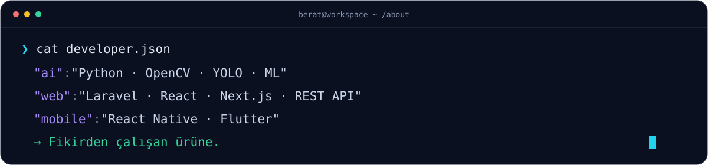
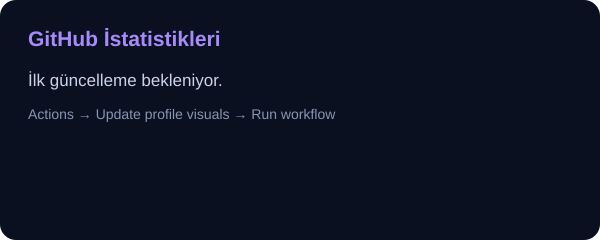

  

<h1 align="center">Merhaba, ben Berat 👋</h1>

  <b>Fikirleri çalışan ürünlere dönüştüren yazılım mühendisi.</b> 
  Web, mobil ve yapay zekâ uygulamalarında gereksinimden canlıya kadar geliştirme.

  
  
  

Ankara, Türkiye · Aksaray Üniversitesi, Yazılım Mühendisliği

### 01 / Hakkımda

Python ile görüntü işleme ve makine öğrenmesi; PHP, Laravel ve JavaScript ekosistemiyle web uygulamaları geliştiriyorum. Mobil tarafta React Native ve Flutter ile çalışıyorum. Bir projenin ihtiyaçlarını anlamaktan arayüzüne, API tasarımından yayına alınmasına kadar geliştirme sürecinde yer almayı seviyorum.

- **Fikirhouse · Full Stack Developer (Part-Time)** — Ocak 2026 – devam ediyor. PHP, Laravel ve MySQL ile 10'dan fazla kurumsal web sitesinin geliştirilmesi ve yayına alınması; REST API tabanlı CRM altyapısı ve React Native mobil uygulama modülleri.
- **BTM Ar-Ge · Yazılım Mühendisliği Stajyeri** — Temmuz – Ağustos 2024. Python, OpenCV, YOLO ve MediaPipe ile gerçek zamanlı personel takibi, kimlik doğrulama ve duruş analizi.
- **Çalışma yaklaşımım** — Anlaşılır kod, sürdürülebilir geliştirme, Git tabanlı ekip çalışması ve gerçek bir ihtiyacı karşılayan ürünler.

  

### 02 / Teknoloji Yığını

<table>
  <tr>
    <td width="50%" valign="top">
      <h4>🧠 AI & Computer Vision</h4>
        
      YOLO · MediaPipe · DeepFace · face_recognition · NumPy · Gemini API
    </td>
    <td width="50%" valign="top">
      <h4>⚡ Frontend & Mobile</h4>
        
      React Native · JavaScript · HTML · CSS · Chart.js · WordPress
    </td>
  </tr>
  <tr>
    <td width="50%" valign="top">
      <h4>⚙️ Backend & Data</h4>
        
      REST API · MySQL · PostgreSQL · Microservices · RabbitMQ
    </td>
    <td width="50%" valign="top">
      <h4>🛠️ DevOps, Desktop & IoT</h4>
        
      Docker Compose · Nginx · Postman · Electron · ESP8266
    </td>
  </tr>
</table>

### 03 / Öne Çıkan Projeler

<table>
  <tr>
    <td width="50%" valign="top">
      <h3>🚌 HatAnaliz</h3>
      <b>Akıllı toplu taşıma analizi</b>
      
YOLOv8 ile yolcu sayımı ve takibi; yaş grubu tahminine dayalı hasılat hesabı. Makine öğrenmesiyle yolcu yoğunluğu ve gelir tahmini, canlı izleme paneli.

      
<code>Python</code> <code>YOLOv8</code> <code>Flask</code> <code>Scikit-learn</code>

      <a href="https://github.com/beratcomert/HatAnaliz">Projeyi incele ↗</a>
    </td>
    <td width="50%" valign="top">
      <h3>🌱 SeraLogix</h3>
      <b>Yapay zekâ destekli sera yönetimi</b>
      
IoT sensörleriyle çevresel veri takibi; hastalık riski ve sulama ihtiyacı tahmini. Next.js paneli, mikroservis altyapısı ve Gemini API ile erken uyarılar.

      
<code>Next.js</code> <code>Node.js</code> <code>Python</code> <code>IoT</code>

      <a href="https://github.com/beratcomert/SeraLogix">Projeyi incele ↗</a>
    </td>
  </tr>
  <tr>
    <td width="50%" valign="top">
      <h3>🛡️ Factory Security System</h3>
      <b>Görüntü işleme ile iş güvenliği</b>
      
Yüz tanıma ile personel doğrulama, MediaPipe ile düşme ve acil durum el hareketi algılama. Olay kaydı ve e-posta bildirimlerini birleştiren masaüstü uygulaması.

      
<code>OpenCV</code> <code>YOLO</code> <code>MediaPipe</code> <code>MySQL</code>

      <a href="https://github.com/beratcomert/factory-security-system">Projeyi incele ↗</a>
    </td>
    <td width="50%" valign="top">
      <h3>🖥️ SysGuard</h3>
      <b>Masaüstü sistem analizi</b>
      
İki kişilik ekipte geliştirdiğimiz; sistem taraması, canlı CPU/RAM takibi ve geçici dosya temizliğini bir araya getiren Electron uygulaması.

      
<code>Electron</code> <code>Node.js</code> <code>Windows API</code> <code>IPC</code>

      <a href="https://github.com/beratcomert/SysGuard">Projeyi incele ↗</a>
    </td>
  </tr>
</table>

  
<b>📱 Mobil uygulama deneyimi</b>

   
  <b>Wikipedia tarzı ansiklopedi uygulaması:</b> Flutter ve Dart ile Android/iOS için kimlik doğrulama, içerik arama ve makale yönetimi. REST API entegrasyonu, durum yönetimi ve arama sonuçları için önbellekleme.
    
  <b>Kurumsal mobil uygulama:</b> Fikirhouse bünyesinde React Native ile iOS/Android uygulamasının geliştirilmesi ve sorumlu olduğum modüllerin yayına hazır hâle getirilmesi.

### 04 / GitHub Aktivitesi

  
  

Herkese açık depolara ait veriler. Dil dağılımı, depolardaki kod miktarını gösterir.

  

### 05 / Birlikte Üretelim

  <b>Web, mobil veya yapay zekâ üzerine konuşalım.</b>  
  <a href="mailto:berat.comertt00@gmail.com">berat.comertt00@gmail.com</a>
  &nbsp; · &nbsp;
  <a href="https://www.linkedin.com/in/berat-c%C3%B6mert-6850812a7">LinkedIn</a>
  &nbsp; · &nbsp;
  <a href="https://github.com/beratcomert?tab=repositories">Tüm projeler</a>

  

